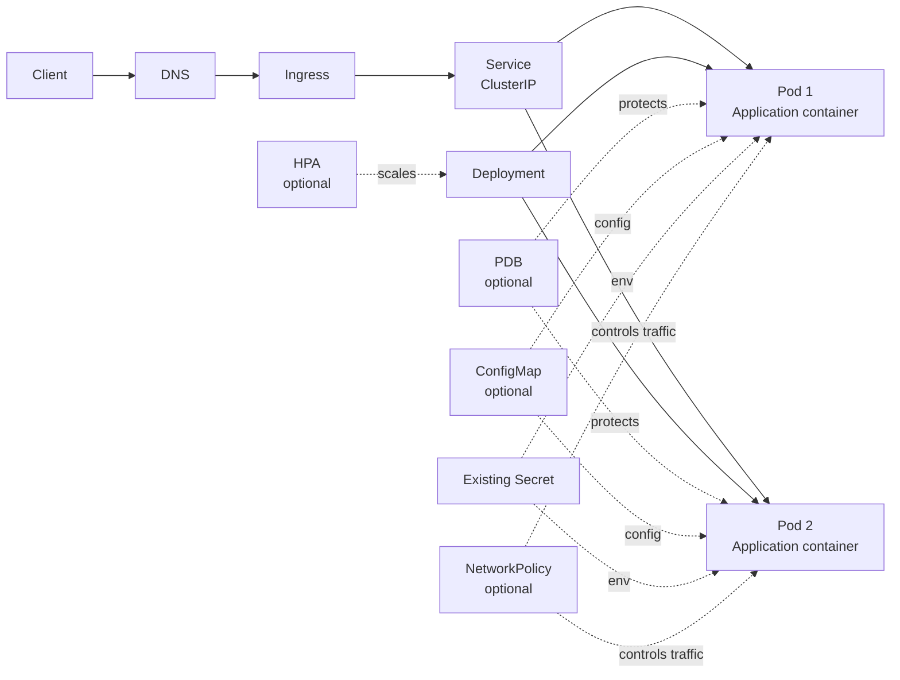
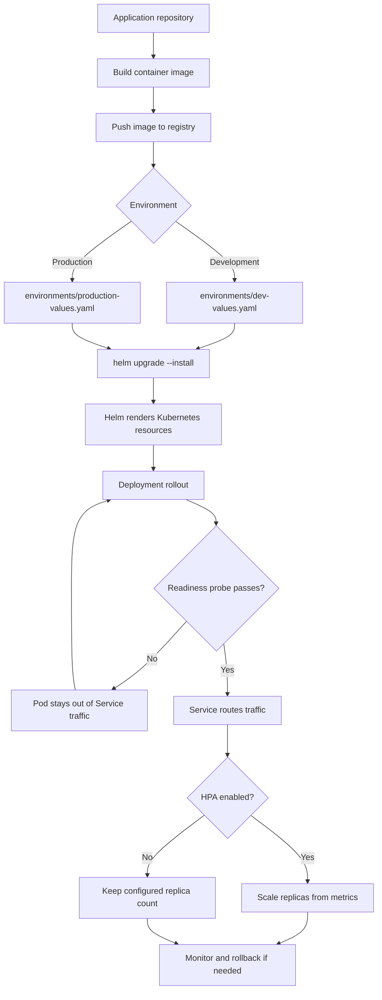

# k8s-app-template

Reusable Helm chart for deploying a containerized application to Kubernetes.

This is application-focused: Deployment, Service, probes, resources, security context, HPA, PDB, Ingress and optional NetworkPolicy. Databases and cluster infrastructure stay outside the chart.

## Kubernetes architecture



### Resource responsibilities

| Resource | Responsibility | Default |
| --- | --- | --- |
| Ingress | External HTTP/HTTPS entry point and host/path routing | Disabled |
| Service | Stable internal endpoint for Pods | Enabled |
| Deployment | Rolling updates and replica management | Enabled |
| Pod | Runs the application container and health probes | Enabled |
| HPA | Scales replicas from CPU utilization | Disabled |
| PDB | Limits voluntary disruption during maintenance | Enabled |
| ConfigMap | Non-sensitive application configuration | Disabled |
| Secret | Sensitive configuration supplied by an existing Secret | Disabled |
| NetworkPolicy | Optional ingress/egress traffic restrictions | Disabled |

Ingress and HPA are intentionally disabled by default because their exact behavior depends on the cluster's ingress controller and metrics server.

## Deployment flow



The normal path is: build an immutable image, select environment-specific values, render and apply the Helm release, then let probes control traffic during rollout. For production, use an image digest instead of a mutable tag.

## Quick start

```bash
helm lint chart
helm template my-app chart --namespace my-app
helm upgrade --install my-app chart \
  --namespace my-app --create-namespace \
  --set image.repository=ghcr.io/your-org/your-app \
  --set image.tag=1.0.0
```

For production, prefer an immutable image digest:

```bash
helm upgrade --install my-app chart \
  --namespace my-app --create-namespace \
  -f environments/production-values.yaml \
  --set image.digest=sha256:...
```

The default chart expects port `8080` and `GET /health`. Override `container.port`, `service.port`, and probe paths when needed.

## Useful commands

```bash
make lint
make template
make install
make uninstall
```

Secrets are referenced rather than stored in Git. Set `secret.existingSecret` to an existing Kubernetes Secret; its keys will be exposed as environment variables.
